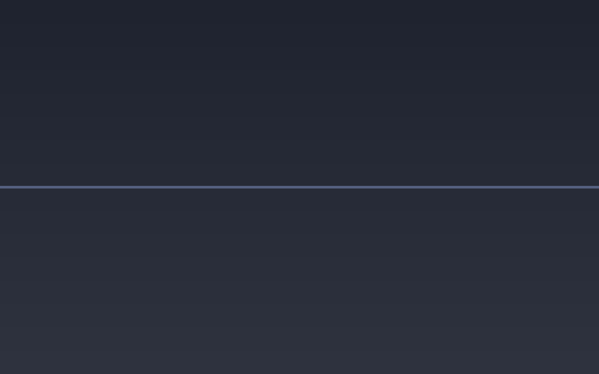

# 💸 Track Your Savings — the dashboard that makes local-first feel real

<figure markdown>
  { .showcase-screenshot loading=lazy }
  <figcaption>The savings view in the Nicx dashboard. The bar on the right is what a month of local Nicx usage would have cost on the cloud — computed per query from your own telemetry.</figcaption>
</figure>

Nicx tracks every inference call you make — the tokens, the latency, the GPU energy — and computes what that same call *would have cost* on OpenAI, Anthropic, Google, and Bedrock. The numbers live in a local SQLite database on your machine and show up in the dashboard of the browser and desktop apps.

A typical month of local-first use looks like:

| | |
|---|---|
| Local inference cost | **`$0.00`** |
| Cloud-equivalent cost | **`$342.18`** (Claude Sonnet baseline) |
| Energy used | **`1.4 kWh`** (~12¢ of grid power) |
| Prompts sent to a third party | **`0`** |

The dollar number is the hook. The bottom row is the actual reason to run Nicx locally.

## Why it's nice

- **You can see what each query costs you.** Not estimated, not "roughly" — measured. Watt-hours per token, FLOPs per token, latency. Every primitive in Nicx treats compute cost as a first-class quantity alongside accuracy.
- **It makes "local-first" stop being abstract.** Watching a bar chart accumulate `$X` a week that *didn't* leave your hands is a different kind of motivating than "your data is private" claims that you can't verify.
- **It stays on your machine.** The savings figures are computed from local telemetry and are never uploaded anywhere.

## How to set this up

You don't, really — it's on by default. Every `nicx ask`, `nicx serve` request, and channel-routed message is metered by local telemetry.

→ **`nicx telemetry stats`** prints the totals (calls, tokens, cost, latency, energy) straight from the local database.

→ **[Telemetry overview](../telemetry.md)** — what's measured, where it's stored, and how it differs from optional usage analytics.
